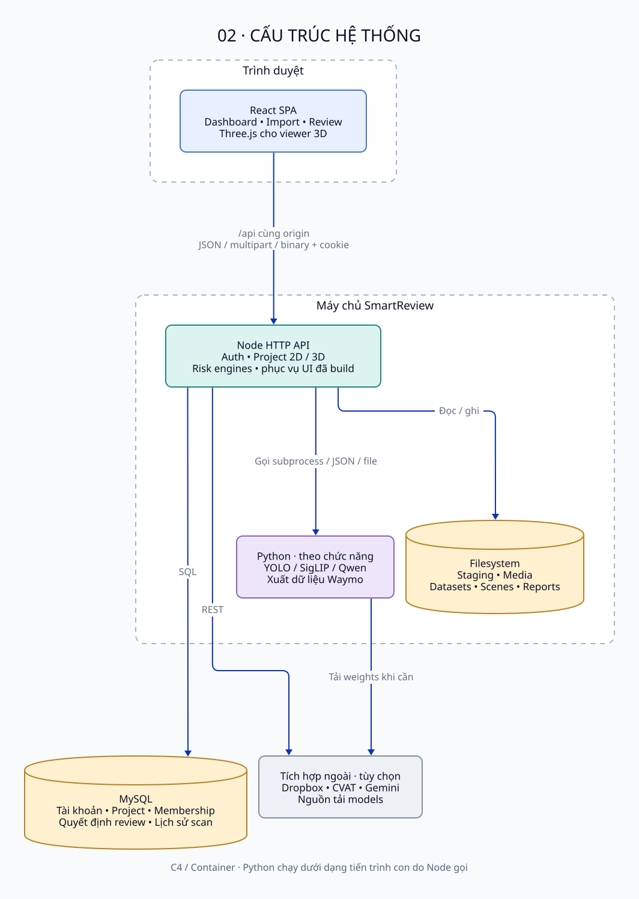
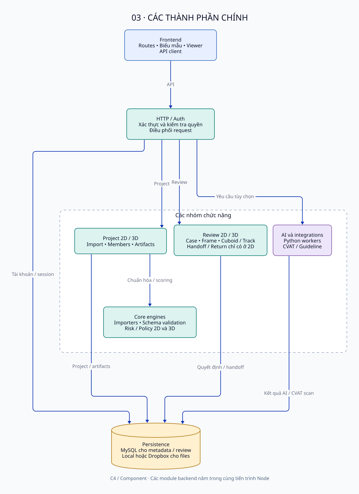

# SmartReview — Kiến trúc hệ thống

SmartReview là hệ thống hỗ trợ kiểm tra chất lượng dữ liệu gán nhãn (annotation) 2D và 3D. Hệ thống nhận dữ liệu, tự động chỉ ra các trường hợp đáng kiểm tra, và để con người đưa ra quyết định cuối cùng.

## 1. Bối cảnh hệ thống

- **Leader**: tạo và quản lý project, nhập dữ liệu, quản lý thành viên.
- **Reviewer / Annotator**: kiểm tra các trường hợp được hệ thống ưu tiên và xử lý nhãn theo quyền trong từng project.
- **CVAT, Dropbox, Gemini** là các hệ thống ngoài **tùy chọn**: CVAT hỗ trợ quét kiểm tra và sửa nhãn bên ngoài, Dropbox làm kho lưu trữ từ xa, Gemini hỗ trợ phân tích văn bản hướng dẫn gán nhãn. Hệ thống vẫn hoạt động với các chức năng lõi khi không dùng các tích hợp này.

SmartReview không tự sửa nhãn và không tự ghi nhãn trở lại CVAT. Việc sửa nhãn diễn ra ở công cụ bên ngoài, sau đó nhãn đã sửa được nộp lại vào hệ thống.

## 2. Cấu trúc hệ thống

| Thành phần | Vai trò |
|---|---|
| React SPA (trình duyệt) | Giao diện quản lý project, nhập dữ liệu, xem kết quả và review; dùng Three.js để hiển thị dữ liệu 3D |
| Node HTTP API (máy chủ) | Xử lý xác thực, phân quyền, quản lý project, điều phối nhập dữ liệu và review; đồng thời phục vụ giao diện đã đóng gói |
| Python — tiến trình con (theo chức năng) | Chạy các tác vụ mô hình AI và xuất dữ liệu Waymo khi được yêu cầu; không phải một dịch vụ độc lập |
| MySQL | Lưu tài khoản, phiên đăng nhập, project, thành viên, quyết định review và lịch sử quét CVAT |
| Hệ thống tệp (máy chủ) | Lưu dữ liệu tạm, ảnh, tập dữ liệu, cảnh 3D và báo cáo; có thể thay bằng Dropbox cho lưu trữ lâu dài |

Người dùng truy cập qua trình duyệt. Giao diện và API dùng chung một địa chỉ, đăng nhập bằng phiên (session) do máy chủ quản lý.

## 3. Các thành phần chính

- **Frontend**: các màn hình project, nhập dữ liệu, dashboard, review 2D và trình xem 3D.
- **Project 2D / 3D**: vòng đời project, nhập và chuẩn hóa dữ liệu, quản lý thành viên và tệp đính kèm.
- **Review**: ghi nhận quyết định kiểm tra cho từng trường hợp; riêng 2D có thêm bàn giao lỗi và nhận nhãn đã sửa.
- **Core engines**: kiểm tra định dạng, chuẩn hóa dữ liệu và các bộ quy tắc chấm rủi ro cho 2D và 3D.
- **AI và tích hợp (tùy chọn)**: các tác vụ mô hình chạy bằng Python, quét CVAT và phân tích guideline. Nhóm này chỉ hoạt động khi môi trường được cấu hình đầy đủ.

Các module backend chạy chung trong một tiến trình Node. Đây là kiến trúc đơn thể (monolith) có tách module rõ ràng, không phải microservices.

## 4. Luồng xử lý chính

**Dữ liệu 2D**: nhãn và ảnh được tải lên, kiểm tra và chuẩn hóa; bộ quy tắc chấm rủi ro tạo danh sách trường hợp cần xem; người dùng review và ghi quyết định. Lỗi có thể được bàn giao để sửa ở công cụ ngoài, nhãn đã sửa nộp lại sẽ tạo phiên bản dữ liệu mới để kiểm tra tiếp.

**Dữ liệu 3D**: một đoạn dữ liệu Waymo được tải lên; Python xuất ra cảnh 3D, đám mây điểm và số đo; bộ quy tắc 3D phân tích trên dữ liệu đã xuất; người dùng xem và đánh giá trực tiếp trên trình xem 3D.

**AI bổ trợ (tùy chọn)**: mô hình có thể bổ sung tín hiệu trước khi chấm rủi ro, so sánh dự đoán với nhãn hiện có, hoặc kiểm tra nhãn theo lớp đối tượng. Kết quả AI chỉ hỗ trợ ưu tiên kiểm tra, quyết định cuối cùng luôn thuộc về người dùng.

## 5. Lưu trữ dữ liệu

Dữ liệu chia hai nhóm cần đi cùng nhau khi sao lưu:

- **MySQL**: thông tin nghiệp vụ — tài khoản, project, thành viên, phiên bản dữ liệu và quyết định review.
- **Tệp (máy chủ hoặc Dropbox)**: nội dung lớn — ảnh, tập dữ liệu đã chuẩn hóa, cảnh 3D, đám mây điểm và báo cáo.

## 6. Triển khai và giới hạn

Hệ thống chạy bằng Node và MySQL, có thể triển khai trực tiếp trên máy chủ hoặc bằng Docker. Các tác vụ Python/AI cần môi trường và trọng số mô hình riêng. Đăng nhập dùng cookie phiên; môi trường production cần HTTPS.

Giới hạn hiện tại cần lưu ý khi trình bày:

- Điểm rủi ro chỉ để **ưu tiên kiểm tra**, không phải kết luận nhãn đúng hay sai.
- Các tác vụ nền và hàng đợi nằm trong bộ nhớ của tiến trình, không bền vững khi máy chủ khởi động lại.
- Dữ liệu 3D hiện tập trung vào từng đoạn Waymo riêng lẻ.
- Bản đóng gói Docker hiện chưa đầy đủ cho luồng 3D và AI, nên chưa xem là môi trường chạy chính thức.
- Chưa có số liệu vận hành chính thức về hiệu năng, độ chính xác tổng quát hay mức sẵn sàng cao (HA/SLA).
