# SmartReview — Kiến trúc hệ thống hiện tại

**Hồ sơ bàn giao kỹ thuật · 17/10/2026 · baseline `8a91f5c911173453d9cacc743899c6e018e6fdc3`**

SmartReview là ứng dụng hỗ trợ kiểm tra chất lượng annotation: import dữ liệu 2D hoặc một segment Waymo 3D, xác định các trường hợp đáng kiểm tra, thu thập quyết định của con người và quản lý vòng sửa nhãn. Hệ thống ưu tiên công việc review; điểm rủi ro không phải xác suất annotation sai và không thay thế ground truth.

Tài liệu này mô tả source tại baseline trên. [Đặc tả thiết kế](system-spec-design.md) chứa yêu cầu, hợp đồng HTTP và data dictionary. [README](README.md) chứa danh mục sơ đồ, cách render, phạm vi kiểm chứng và cách đọc dẫn chiếu source.

## 1. Quy ước bằng chứng và phạm vi

Hai trục trạng thái được dùng độc lập:

| Trạng thái triển khai | Ý nghĩa |
|---|---|
| **Implemented** | Có code và đường gọi từ runtime / giao diện hoặc CLI được nêu rõ |
| **Configured** | Có cấu hình / manifest để bật kết nối; không chứng minh kết nối hoạt động |
| **Planned / draft** | Chỉ là proposal, rule metadata hoặc mô tả ý định; không vẽ như tính năng đang chạy |
| **Chưa xác minh runtime** | Chưa chạy tích hợp, inference hoặc triển khai tương ứng; có thể đi kèm Implemented |

Source TypeScript, Python, SQL và manifests được ưu tiên hơn README cũ. Dẫn chiếu có dạng `file:dòng`, liên kết GitHub cố định tới source baseline. Các số dòng chỉ có giá trị với commit baseline. Không dùng `.env`, nội dung dataset hoặc dữ liệu khách hàng làm tài liệu bàn giao.

Không có thay đổi ứng dụng, migration, cấu hình hay dữ liệu nghiệp vụ trong quá trình tạo hồ sơ này. Không chạy MySQL, CVAT, Dropbox, Gemini, inference models hay Docker để kiểm chứng end-to-end.

## 2. Bối cảnh và ranh giới hệ thống

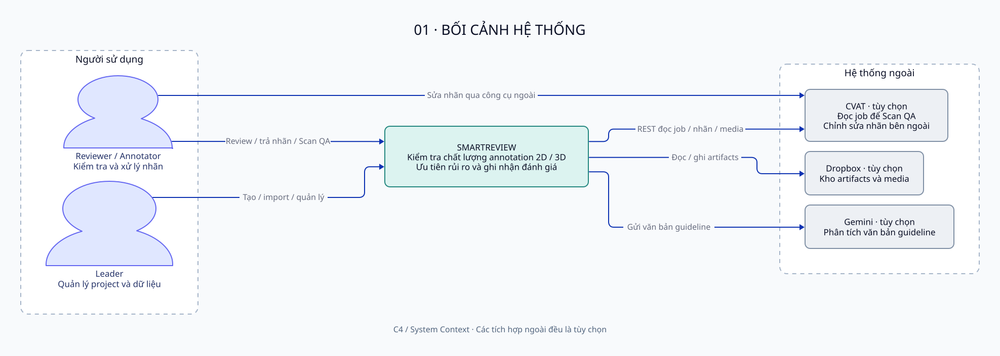

[Nguồn D2](diagrams/sources/01-system-context.d2)

- **Leader** tạo project, import, quản lý thành viên và các tác vụ AI. Leader toàn cục quản lý được các project không bị ẩn; chỉ chủ tạo được ẩn và thường là người được xóa project.
- **Reviewer** và **Annotator** là vai trò trong từng project của tài khoản `member`. Reviewer có thể thêm annotator và gửi handoff. Các thành viên có quyền truy cập đều có thể lưu quyết định case/frame qua API; không có chính sách backend “chỉ reviewer mới được ghi review”.
- **CVAT** là hệ thống ngoài: server đọc job/annotation/media để Scan QA; vòng sửa 2D sử dụng xuất/nhập file. Không có tự động ghi annotation về CVAT.
- **Dropbox** là remote storage duy nhất được adapter hỗ trợ; không bắt buộc khi dùng local storage.
- **Gemini** chỉ được gọi cho phân tích guideline khi cấu hình key và người dùng yêu cầu. Văn bản guideline rời máy chủ ở luồng này.

Nguồn: [web/server/projects/members.ts:59](https://github.com/sithanh1602/Smartreview-Build/blob/8a91f5c911173453d9cacc743899c6e018e6fdc3/web/server/projects/members.ts#L59), [web/server/projects/http.ts:151](https://github.com/sithanh1602/Smartreview-Build/blob/8a91f5c911173453d9cacc743899c6e018e6fdc3/web/server/projects/http.ts#L151), [web/server/projects/http.ts:202](https://github.com/sithanh1602/Smartreview-Build/blob/8a91f5c911173453d9cacc743899c6e018e6fdc3/web/server/projects/http.ts#L202), [web/server/cvat/client.ts:27](https://github.com/sithanh1602/Smartreview-Build/blob/8a91f5c911173453d9cacc743899c6e018e6fdc3/web/server/cvat/client.ts#L27), [web/server/storage/remote.ts:15](https://github.com/sithanh1602/Smartreview-Build/blob/8a91f5c911173453d9cacc743899c6e018e6fdc3/web/server/storage/remote.ts#L15), [web/server/guideline/model-call.ts:185](https://github.com/sithanh1602/Smartreview-Build/blob/8a91f5c911173453d9cacc743899c6e018e6fdc3/web/server/guideline/model-call.ts#L185).

## 3. Container và công nghệ

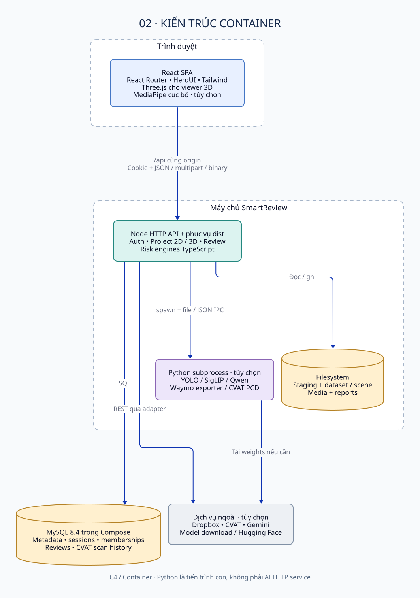

[Nguồn D2](diagrams/sources/02-container-architecture.d2)

| Đơn vị chạy / lưu trữ | Implementation và trách nhiệm |
|---|---|
| Browser SPA | React 19.2, React Router 7.9, HeroUI 3.2, Tailwind 4; dashboard, nhập liệu, review; Three.js 0.186 cho 3D; MediaPipe cho điều khiển tay tùy chọn |
| Node server | Native `node:http`; route handlers và services TypeScript chạy trực tiếp trên Node ≥22.18; production Docker dùng Node 24; phục vụ `dist` và `/api` |
| Core libraries | Importers, Ajv schema validation, normalization, risk/policy engines 2D/3D; được gọi trong tiến trình Node |
| Python children | YOLO scoring / predictions, label verification, xuất Waymo, đo CVAT PCD; `spawn` và file/stdio JSON, không có REST AI service độc lập |
| MySQL | Metadata, auth, memberships, revisions, risk-case index, quyết định review, handoff, CVAT scan history; Compose pin MySQL 8.4 |
| Filesystem / Dropbox | Media, canonical datasets, scenes, binary clouds, risk reports và kết quả AI; local staging vẫn cần thiết khi dùng remote |

Nguồn phiên bản: [web/package.json:32](https://github.com/sithanh1602/Smartreview-Build/blob/8a91f5c911173453d9cacc743899c6e018e6fdc3/web/package.json#L32), [web/package.json:61](https://github.com/sithanh1602/Smartreview-Build/blob/8a91f5c911173453d9cacc743899c6e018e6fdc3/web/package.json#L61), [web/server/index.ts:12](https://github.com/sithanh1602/Smartreview-Build/blob/8a91f5c911173453d9cacc743899c6e018e6fdc3/web/server/index.ts#L12), [web/server/app.ts:222](https://github.com/sithanh1602/Smartreview-Build/blob/8a91f5c911173453d9cacc743899c6e018e6fdc3/web/server/app.ts#L222), [compose.yaml:5](https://github.com/sithanh1602/Smartreview-Build/blob/8a91f5c911173453d9cacc743899c6e018e6fdc3/compose.yaml#L5). Đây là versions/ranges khai báo trong manifest, không phải cam kết mọi máy đang chạy đúng phiên bản đó.

### 3.1. Cấu trúc repository và phạm vi runtime

| Vùng source | Vai trò | Phân loại |
|---|---|---|
| `web/src/` | UI, routes, state/hooks, API client, 2D overlay, Three.js viewer | Runtime browser |
| `web/server/` | HTTP, auth, domain services, storage, SQL, Python adapters | Runtime Node / workers |
| `web/core/schema/`, `importers/`, `exporters/` | Contract dữ liệu, import nhiều định dạng, CVAT XML export | Runtime library / CLI reuse |
| `web/core/risk/`, `risk3d/` | Engines hiện tại; `risk_v*` giữ compatibility 2D cũ | Runtime library |
| `web/policy/`, `web/policy3d/` | Ngưỡng và rule data; chỉ rule có code thực thi mới được xem là active | Runtime data / một phần draft metadata |
| `web/shared/` | Validation review/frame, Waymo, guideline waivers, types dùng chung | Runtime shared code |
| `web/scripts/`, `docker/`, `compose.yaml` | Dev, migration, user CLI, import/offline analysis, packaging | Tooling / deployment |
| `web/tests/` | Pure/unit, DB integration và browser tests | Verification; không đồng nghĩa đã chạy toàn bộ |
| `ai-service/score_boxes.py` | Import rescore được `server/ai/rescore.py` gọi | **Có runtime caller** |
| Các script detect/track/prelabel, benchmark và risk artifacts trong `ai-service/` | Thử nghiệm / CLI / nghiên cứu được giữ trong repo | Không là AI HTTP container trong ứng dụng |

Không gọi toàn bộ `ai-service/` là legacy: `score_boxes.py` thực sự được dùng khi bật import rescore. Ngược lại, tên thư mục `ai-service` không chứng minh một microservice đang được triển khai. Nguồn: [web/server/ai/rescore.py:5](https://github.com/sithanh1602/Smartreview-Build/blob/8a91f5c911173453d9cacc743899c6e018e6fdc3/web/server/ai/rescore.py#L5), [web/server/ai/rescore.ts:150](https://github.com/sithanh1602/Smartreview-Build/blob/8a91f5c911173453d9cacc743899c6e018e6fdc3/web/server/ai/rescore.ts#L150).

### 3.2. Topology tiến trình và startup

`server/index.ts` tạo pool MySQL, storage adapter, services 2D/3D và auth; chạy recovery rồi mới listen. Không nạp dataset demo mặc định. Các routes legacy `/api/meta`, `/api/cases` ngoài project còn tồn tại trong handler nhưng startup tiêu chuẩn không truyền dataset vào; chúng không đại diện một demo đang hoạt động.

Pool giới hạn 5 connections, UTC, `utf8mb4`, `dateStrings`, `multipleStatements=false`. Dữ liệu JSON/file không được đưa toàn bộ vào schema quan hệ. Cache và task guards dùng `Map`/`Set` trong tiến trình; không có Redis, durable queue hay worker cluster. Sau restart, các project import chưa hoàn tất chuyển `FAILED`; không tự resume.

Nguồn: [web/server/index.ts:17](https://github.com/sithanh1602/Smartreview-Build/blob/8a91f5c911173453d9cacc743899c6e018e6fdc3/web/server/index.ts#L17), [web/server/index.ts:27](https://github.com/sithanh1602/Smartreview-Build/blob/8a91f5c911173453d9cacc743899c6e018e6fdc3/web/server/index.ts#L27), [web/server/db/pool.ts:17](https://github.com/sithanh1602/Smartreview-Build/blob/8a91f5c911173453d9cacc743899c6e018e6fdc3/web/server/db/pool.ts#L17), [web/server/projects/service.ts:102](https://github.com/sithanh1602/Smartreview-Build/blob/8a91f5c911173453d9cacc743899c6e018e6fdc3/web/server/projects/service.ts#L102), [web/server/projects3d/service.ts:103](https://github.com/sithanh1602/Smartreview-Build/blob/8a91f5c911173453d9cacc743899c6e018e6fdc3/web/server/projects3d/service.ts#L103).

## 4. Thành phần frontend

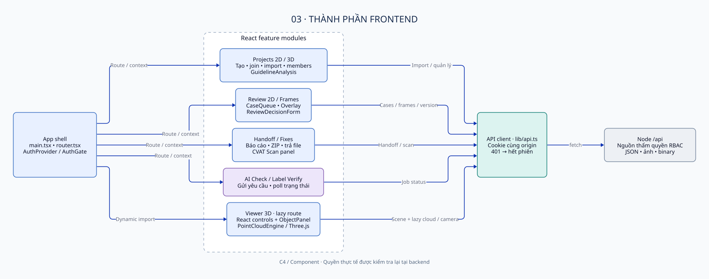

[Nguồn D2](diagrams/sources/03-frontend-components.d2)

`AuthProvider` bọc router. `AuthGate` điều hướng theo phiên và vai trò UI; backend vẫn kiểm tra quyền ở mỗi request. Vai trò reviewer/annotator mà member chọn cho tab lưu trong `sessionStorage` chỉ điều chỉnh trải nghiệm, không cấp thêm quyền project. Client gọi cùng origin, xử lý 401 bằng sự kiện hết phiên; không refresh token. Phiên được kiểm tra lại định kỳ / khi tab visible và đồng bộ logout qua BroadcastChannel.

Các nhóm giao diện chính:

1. Projects: danh sách 2D/3D, create/join, upload, members/invites, dashboard, guideline.
2. Review: hàng đợi ưu tiên, case detail, overlay và quyết định có version; whole-frame review ghi vùng thiếu.
3. Handoff/Fixes: snapshot lỗi, chọn annotator, ZIP CVAT, trả nhãn và đối chiếu thay đổi.
4. AI: request và poll AI Check / label verifier; kết quả hai luồng không được gộp thành một loại score.
5. Viewer 3D: route lazy tải Three.js; React điều khiển `PointCloudEngine`, engine render ngoài React render loop, tải cloud/camera theo nhu cầu.

Nguồn: [web/src/main.tsx:22](https://github.com/sithanh1602/Smartreview-Build/blob/8a91f5c911173453d9cacc743899c6e018e6fdc3/web/src/main.tsx#L22), [web/src/app/router.tsx:21](https://github.com/sithanh1602/Smartreview-Build/blob/8a91f5c911173453d9cacc743899c6e018e6fdc3/web/src/app/router.tsx#L21), [web/src/features/auth/AuthProvider.tsx:25](https://github.com/sithanh1602/Smartreview-Build/blob/8a91f5c911173453d9cacc743899c6e018e6fdc3/web/src/features/auth/AuthProvider.tsx#L25), [web/src/lib/api.ts:35](https://github.com/sithanh1602/Smartreview-Build/blob/8a91f5c911173453d9cacc743899c6e018e6fdc3/web/src/lib/api.ts#L35), [web/src/features/projects3d/viewer/engine.ts:103](https://github.com/sithanh1602/Smartreview-Build/blob/8a91f5c911173453d9cacc743899c6e018e6fdc3/web/src/features/projects3d/viewer/engine.ts#L103).

MediaPipe nhận webcam qua `getUserMedia`, suy luận trong browser; có fallback tải model từ Google Storage khi không có model local. Không tìm thấy API upload webcam frames trong đường gọi này. Không suy diễn điều đó thành bảo đảm không có network traffic: vẫn có tải model/wasm. Nguồn: [web/src/features/projects3d/viewer/HandControl.tsx:10](https://github.com/sithanh1602/Smartreview-Build/blob/8a91f5c911173453d9cacc743899c6e018e6fdc3/web/src/features/projects3d/viewer/HandControl.tsx#L10), [web/src/features/projects3d/viewer/HandControl.tsx:129](https://github.com/sithanh1602/Smartreview-Build/blob/8a91f5c911173453d9cacc743899c6e018e6fdc3/web/src/features/projects3d/viewer/HandControl.tsx#L129).

## 5. Thành phần backend và ownership

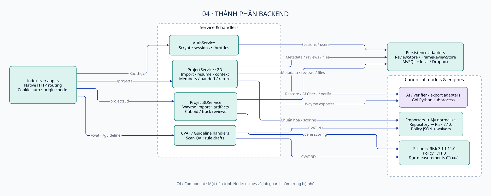

[Nguồn D2](diagrams/sources/04-backend-components.d2)

| Thành phần | Dữ liệu sở hữu / trách nhiệm |
|---|---|
| `app.ts`, `auth/http.ts` | Routing, JSON/error envelope, session cookie, write-origin checks, SPA/assets |
| `AuthService` | Đăng ký/đăng nhập, scrypt, opaque sessions, cleanup và DB-backed throttles |
| `ProjectService` | Vòng đời 2D, staging/finish/resume, dataset context/cache, membership/handoff/return orchestration |
| `repository.ts` | Đọc canonical dataset, chọn engine theo version, tạo fingerprint, projection case và assets, synthetic missing cases |
| `ReviewStore`, `FrameReviewStore` | SQL revision/case registration, quyết định hiện tại, metrics, optimistic version / transactions |
| `Project3DService` | Waymo exporter, scene/cloud/camera publishing, scoring 3D, scene index, reviews/rescore |
| `AiService`, `VerifyService` | Tác vụ độc lập, guards, Python IPC, status/progress/result persistence |
| `CvatScans` | Nạp job bằng server token, map dữ liệu, QA 2D/3D, lưu lịch sử theo user |
| `guideline/*` | Gemini schema extraction / checks, optional external module, chỉ trả drafts |
| `RemoteStorage` / `DropboxStorage` | OAuth refresh, REST file operations; adapter chỉ hỗ trợ Dropbox |

Các thành phần là modules trong cùng tiến trình; mũi tên component thể hiện phụ thuộc/call, không phải HTTP liên dịch vụ. Nguồn: [web/server/projects/service.ts:85](https://github.com/sithanh1602/Smartreview-Build/blob/8a91f5c911173453d9cacc743899c6e018e6fdc3/web/server/projects/service.ts#L85), [web/server/projects3d/service.ts:69](https://github.com/sithanh1602/Smartreview-Build/blob/8a91f5c911173453d9cacc743899c6e018e6fdc3/web/server/projects3d/service.ts#L69), [web/server/reviews/store.ts:34](https://github.com/sithanh1602/Smartreview-Build/blob/8a91f5c911173453d9cacc743899c6e018e6fdc3/web/server/reviews/store.ts#L34), [web/server/cvat/scans.ts:90](https://github.com/sithanh1602/Smartreview-Build/blob/8a91f5c911173453d9cacc743899c6e018e6fdc3/web/server/cvat/scans.ts#L90).

## 6. Workflows và data flow

### 6.1. Import 2D và tạo revision

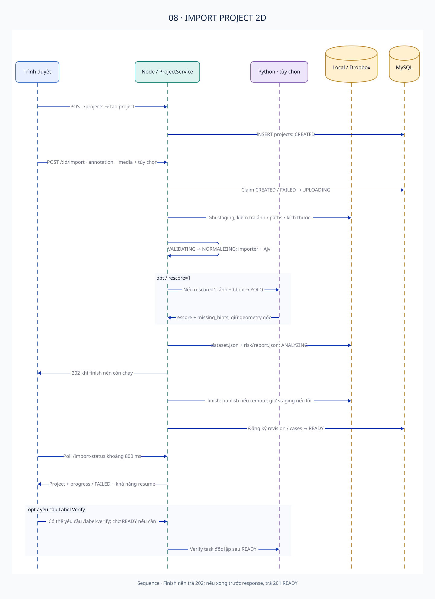

Leader tạo project chọn một trong 10 định dạng. Browser có thể giải nén ZIP để chọn file; backend upload không nhận ZIP, video hay SVG. Annotation video có thể đi cùng ảnh các frame đã trích xuất. Server xác minh file, kích thước ảnh, tham chiếu frame, giới hạn dữ liệu rồi chuẩn hóa với Ajv. Không tự bịa track, confidence hoặc provenance.

Trạng thái lưu SQL: `CREATED → UPLOADING → VALIDATING → NORMALIZING → ANALYZING → READY`; lỗi dẫn đến `FAILED`. Rescore tùy chọn chạy trong phần xử lý request trước khi ghi canonical dataset / initial risk report. Chỉ bước `finish` (publish + SQL) được `index.ts` bật chạy nền. Vì vậy “import async” không có nghĩa toàn bộ upload / inference / normalization rời khỏi request. API trả 201 khi READY hoặc 202 nếu finish chưa xong.

Lỗi trước finish xóa staging; lỗi publish/SQL giữ staging để `/import/resume` tiếp tục trên **máy giữ staging**. Tạo lại import sẽ thay dữ liệu pending. Frontend poll `/import-status` khoảng 800 ms; tiến độ chi tiết nằm trong memory. Nguồn: [web/server/projects/service.ts:575](https://github.com/sithanh1602/Smartreview-Build/blob/8a91f5c911173453d9cacc743899c6e018e6fdc3/web/server/projects/service.ts#L575), [web/server/projects/service.ts:711](https://github.com/sithanh1602/Smartreview-Build/blob/8a91f5c911173453d9cacc743899c6e018e6fdc3/web/server/projects/service.ts#L711), [web/server/projects/service.ts:716](https://github.com/sithanh1602/Smartreview-Build/blob/8a91f5c911173453d9cacc743899c6e018e6fdc3/web/server/projects/service.ts#L716), [web/server/projects/http.ts:141](https://github.com/sithanh1602/Smartreview-Build/blob/8a91f5c911173453d9cacc743899c6e018e6fdc3/web/server/projects/http.ts#L141), [web/src/features/projects/ImportForm.tsx:364](https://github.com/sithanh1602/Smartreview-Build/blob/8a91f5c911173453d9cacc743899c6e018e6fdc3/web/src/features/projects/ImportForm.tsx#L364).

### 6.2. Review → handoff → sửa bên ngoài → return

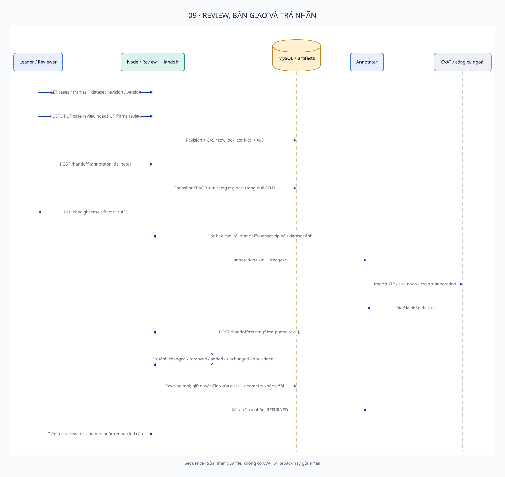

Case review và frame review là hai aggregate khác nhau. Case có `CORRECT/ERROR/UNSURE`, loại lỗi và version. Frame có trạng thái cùng các bbox vùng thiếu. Sau khi handoff SENT, ghi review case/frame bị khóa 423 đến khi leader reopen. Handoff chỉ chứa các lỗi được xác nhận ERROR và vùng thiếu; không tự đưa toàn bộ unreviewed vào danh sách lỗi.

ZIP export là CVAT for images 1.1 + ảnh, chỉ dành dataset ảnh rời. Annotator dùng CVAT hoặc công cụ ngoài rồi upload **các file nhãn dạng text** để return. Server tái dùng media, tạo revision mới, giữ quyết định khi class và geometry không đổi, và phân loại `changed/removed/added/unchanged/not_added`. Dung sai so geometry bbox/polygon là 0,51 pixel; đây là lựa chọn implementation cho export làm tròn.

Handoff có một hàng hiện tại / project; gửi vòng mới xóa hàng cũ. Không có durable lịch sử từng vòng, email, Slack hay auto CVAT writeback. Nguồn: [web/server/projects/http.ts:3](https://github.com/sithanh1602/Smartreview-Build/blob/8a91f5c911173453d9cacc743899c6e018e6fdc3/web/server/projects/http.ts#L3), [web/server/projects/handoff.ts:78](https://github.com/sithanh1602/Smartreview-Build/blob/8a91f5c911173453d9cacc743899c6e018e6fdc3/web/server/projects/handoff.ts#L78), [web/server/projects/handoff.ts:154](https://github.com/sithanh1602/Smartreview-Build/blob/8a91f5c911173453d9cacc743899c6e018e6fdc3/web/server/projects/handoff.ts#L154), [web/server/projects/service.ts:435](https://github.com/sithanh1602/Smartreview-Build/blob/8a91f5c911173453d9cacc743899c6e018e6fdc3/web/server/projects/service.ts#L435), [web/server/projects/handoff.ts:333](https://github.com/sithanh1602/Smartreview-Build/blob/8a91f5c911173453d9cacc743899c6e018e6fdc3/web/server/projects/handoff.ts#L333).

### 6.3. Import và review Waymo 3D

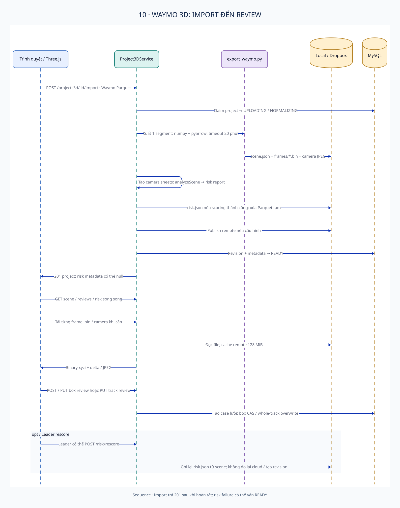

Một project nhận một segment Waymo v2: lidar, lidar calibration, vehicle pose, lidar boxes; tùy chọn lidar pose và camera. Python dùng numpy/pyarrow, không cần TensorFlow/Waymo SDK, xuất return 1 của range image thành cloud, bù chuyển động TOP khi có poses, đo các thuộc tính cuboid phục vụ engine. Scene / cloud / camera được publish; raw Parquet staging bị xóa và không được publish.

Engine 3D `3d-1.11.0`, policy `_scene.json` version `1.11.0`, chỉ đọc scene và measurements đã đo khi import; không tải cloud để scoring. Nếu scoring thất bại nhưng scene hợp lệ, project vẫn có thể READY với metadata risk null. Import trả 201 sau khi hoàn tất, khác finish nền 2D.

Browser tải scene/reviews/risk song song, cloud binary và ảnh lazy. Review từng cuboid dùng version; review cả track ghi đè các frame của đối tượng mà không CAS riêng từng cuboid. `risk/rescore` ghi lại `risk.json` và engine metadata, không tạo revision, không đo cloud lại; thay đổi exporter cần reimport. Gap signals không tự thành scored case có form review như cuboid hiện hữu.

Nguồn: [web/shared/waymo.ts:15](https://github.com/sithanh1602/Smartreview-Build/blob/8a91f5c911173453d9cacc743899c6e018e6fdc3/web/shared/waymo.ts#L15), [web/server/projects3d/export_waymo.py:32](https://github.com/sithanh1602/Smartreview-Build/blob/8a91f5c911173453d9cacc743899c6e018e6fdc3/web/server/projects3d/export_waymo.py#L32), [web/server/projects3d/service.ts:27](https://github.com/sithanh1602/Smartreview-Build/blob/8a91f5c911173453d9cacc743899c6e018e6fdc3/web/server/projects3d/service.ts#L27), [web/core/risk3d/engine.ts:6](https://github.com/sithanh1602/Smartreview-Build/blob/8a91f5c911173453d9cacc743899c6e018e6fdc3/web/core/risk3d/engine.ts#L6), [web/server/projects3d/service.ts:332](https://github.com/sithanh1602/Smartreview-Build/blob/8a91f5c911173453d9cacc743899c6e018e6fdc3/web/server/projects3d/service.ts#L332), [web/server/projects3d/http.ts:123](https://github.com/sithanh1602/Smartreview-Build/blob/8a91f5c911173453d9cacc743899c6e018e6fdc3/web/server/projects3d/http.ts#L123), [web/server/projects3d/service.ts:495](https://github.com/sithanh1602/Smartreview-Build/blob/8a91f5c911173453d9cacc743899c6e018e6fdc3/web/server/projects3d/service.ts#L495).

### 6.4. CVAT Scan QA

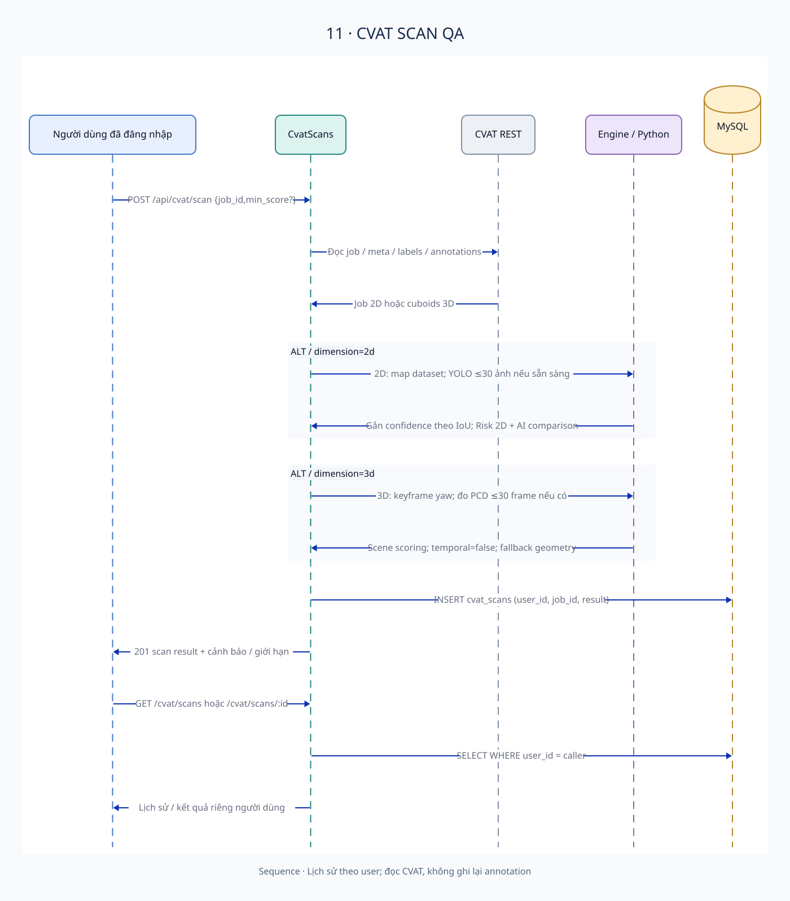

Mọi người dùng đăng nhập được scan một job bằng quyền của **CVAT token phía server**; không có mapping danh tính/ACL CVAT theo từng user SmartReview. Lịch sử kết quả lại được giới hạn `user_id` của caller, 50 kết quả gần nhất.

Nhánh 2D map annotation → dataset, có thể YOLO trên tối đa 30 frame đã annotation; confidence gắn theo overlap IoU ≥0,35 không phụ thuộc class, chạy engine với min score mặc định 10 rồi bổ sung AI comparison. Luồng này khác AI Check project vì confidence có thể ảnh hưởng risk scoring ngay trong scan.

Nhánh 3D đọc keyframes cuboid yaw-only, không nội suy / ego-pose; giới hạn span 2000 frame, đo PCD tối đa 30 frame nếu worker sẵn sàng, geometry fallback khi thiếu. Temporal checks tắt. Không dùng YOLO cho cuboid. Scan không sửa dữ liệu CVAT. Nguồn: [web/server/cvat/client.ts:6](https://github.com/sithanh1602/Smartreview-Build/blob/8a91f5c911173453d9cacc743899c6e018e6fdc3/web/server/cvat/client.ts#L6), [web/server/cvat/scans.ts:124](https://github.com/sithanh1602/Smartreview-Build/blob/8a91f5c911173453d9cacc743899c6e018e6fdc3/web/server/cvat/scans.ts#L124), [web/server/cvat/scans.ts:66](https://github.com/sithanh1602/Smartreview-Build/blob/8a91f5c911173453d9cacc743899c6e018e6fdc3/web/server/cvat/scans.ts#L66), [web/server/cvat/scans.ts:276](https://github.com/sithanh1602/Smartreview-Build/blob/8a91f5c911173453d9cacc743899c6e018e6fdc3/web/server/cvat/scans.ts#L276), [web/server/cvat/scan3d.ts:103](https://github.com/sithanh1602/Smartreview-Build/blob/8a91f5c911173453d9cacc743899c6e018e6fdc3/web/server/cvat/scan3d.ts#L103).

### 6.5. Guideline và waiver

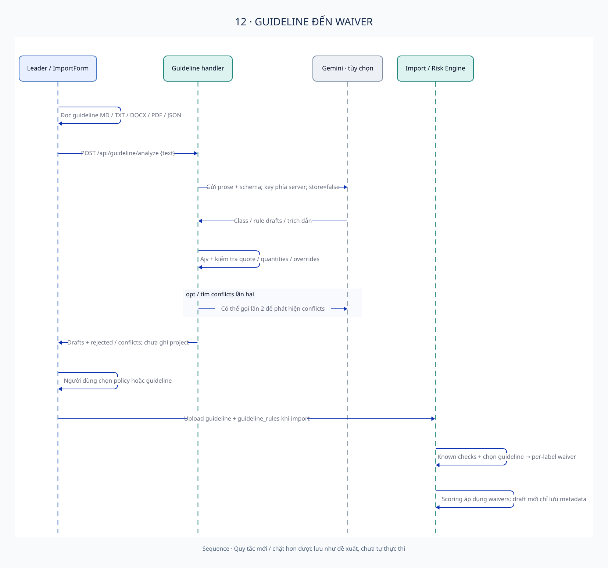

`/api/guideline/analyze` chỉ trả drafts, không ghi project. Built-in implementation gửi prose tới Gemini Interactions API, model mặc định trong source là `gemini-3.5-flash-lite`, thinking `medium`, timeout 300 giây cho mỗi call, `store:false`. Có thể gọi lần hai cho conflicts. Ajv, kiểm tra trích dẫn và semantics lọc output; đây không phải cơ chế biên dịch rule tùy ý thành code.

Người dùng lựa chọn bản policy hay guideline. Các lựa chọn nới lỏng tương ứng known checks có thể thành **per-label waivers** khi import. Rule mới / stricter, reviewer instructions, thiếu quantities/parameters là drafts/metadata, không tự thực thi. `GUIDELINE_RULES_DIR` cho phép nạp code ngoài repository; nội dung module ngoài chưa được kiểm tra và không được coi đã hoạt động.

Nguồn: [web/server/guideline/http.ts:10](https://github.com/sithanh1602/Smartreview-Build/blob/8a91f5c911173453d9cacc743899c6e018e6fdc3/web/server/guideline/http.ts#L10), [web/server/guideline/model-call.ts:189](https://github.com/sithanh1602/Smartreview-Build/blob/8a91f5c911173453d9cacc743899c6e018e6fdc3/web/server/guideline/model-call.ts#L189), [web/server/guideline/model-call.ts:258](https://github.com/sithanh1602/Smartreview-Build/blob/8a91f5c911173453d9cacc743899c6e018e6fdc3/web/server/guideline/model-call.ts#L258), [web/shared/guideline-waivers.ts:25](https://github.com/sithanh1602/Smartreview-Build/blob/8a91f5c911173453d9cacc743899c6e018e6fdc3/web/shared/guideline-waivers.ts#L25), [web/server/guideline/external.ts:11](https://github.com/sithanh1602/Smartreview-Build/blob/8a91f5c911173453d9cacc743899c6e018e6fdc3/web/server/guideline/external.ts#L11).

## 7. AI pipeline và giới hạn diễn giải

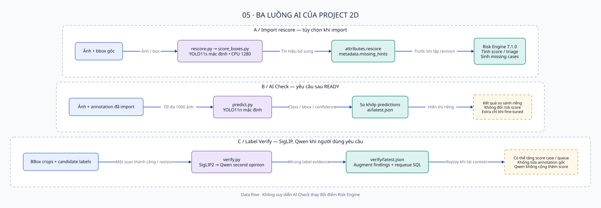

| Luồng | Trigger / input | Output | Tác động dữ liệu |
|---|---|---|---|
| Import rescore | `rescore=1`, ảnh + bbox; YOLO11s mặc định, n/s/m chọn được | `attributes.rescore`, missing hints | Có ảnh hưởng initial risk/revision; không di chuyển hay chèn annotation gốc |
| AI Check | Leader yêu cầu sau READY; YOLO11n mặc định | `ai/latest.json`, findings so sánh | Không thay đổi risk score/report gốc; extra annotation chỉ với fine-tuned flag |
| Label Verify | Một successful scan/revision; SigLIP2, Qwen khi yêu cầu | `verify/latest.json`, combined findings | Augment loaded cases, có thể tăng score và requeue SQL; không sửa dataset / initial report |
| Waymo exporter | Import 3D | Scene / cloud / measurements | Chuyển đổi dữ liệu hình học, không phải model nhận dạng học máy |
| Gemini guideline | Leader analyze prose | Drafts / conflicts / rejected | Không scoring cho đến khi lựa chọn phù hợp được chuyển thành waiver |

YOLO import rescore dùng CPU 1280; weights có thể được tải lần đầu. AI Check tối đa 1000 ảnh / 20 phút, một job đang chạy mỗi instance. Verifier tối đa 1000 ảnh / 30 phút mỗi worker call, pending queue nằm trong memory, SigLIP CPU fallback; Qwen dùng GPU / quantization theo worker. `available()` kiểm tra file Python (AI Check thêm weights), không bảo đảm packages/models/GPU sẵn sàng.

Risk 2D hiện tại `7.1.0`, policy `5.1.0`; giữ các engine snapshots cũ để nạp dữ liệu đã có bằng stored version. Score bị cap 100, mặc định queue threshold 30; severity high ≥70 / medium ≥40. Warning không cộng điểm; một số weak rule family lấy maximum để tránh đếm trùng. Non-bbox geometry được schema giữ nhưng engine 2D không đo như bbox và có thể chặn auto-accept. Các tier `auto_accept/verify/relabel` là triage theo rule/gates, không phải bảo đảm chất lượng.

Nguồn: [web/core/risk/engine.ts:62](https://github.com/sithanh1602/Smartreview-Build/blob/8a91f5c911173453d9cacc743899c6e018e6fdc3/web/core/risk/engine.ts#L62), [web/core/risk/engine.ts:60](https://github.com/sithanh1602/Smartreview-Build/blob/8a91f5c911173453d9cacc743899c6e018e6fdc3/web/core/risk/engine.ts#L60), [web/core/risk/engine.ts:389](https://github.com/sithanh1602/Smartreview-Build/blob/8a91f5c911173453d9cacc743899c6e018e6fdc3/web/core/risk/engine.ts#L389), [web/core/risk/types.ts:47](https://github.com/sithanh1602/Smartreview-Build/blob/8a91f5c911173453d9cacc743899c6e018e6fdc3/web/core/risk/types.ts#L47), [web/server/verify/queue.ts:11](https://github.com/sithanh1602/Smartreview-Build/blob/8a91f5c911173453d9cacc743899c6e018e6fdc3/web/server/verify/queue.ts#L11), [web/server/ai/service.ts:128](https://github.com/sithanh1602/Smartreview-Build/blob/8a91f5c911173453d9cacc743899c6e018e6fdc3/web/server/ai/service.ts#L128), [web/server/verify/service.ts:37](https://github.com/sithanh1602/Smartreview-Build/blob/8a91f5c911173453d9cacc743899c6e018e6fdc3/web/server/verify/service.ts#L37), [web/server/verify/verify.py:95](https://github.com/sithanh1602/Smartreview-Build/blob/8a91f5c911173453d9cacc743899c6e018e6fdc3/web/server/verify/verify.py#L95), [web/server/verify/label-verifier.ts:30](https://github.com/sithanh1602/Smartreview-Build/blob/8a91f5c911173453d9cacc743899c6e018e6fdc3/web/server/verify/label-verifier.ts#L30).

Các con số accuracy/tốc độ xuất hiện trong comment, UI model catalog hoặc benchmark không được nâng thành SLA/accuracy của hệ thống. 3D policy được hiệu chỉnh chủ yếu trên một segment Waymo, không đủ để khẳng định tổng quát; cyclist còn thiếu measurements kiểm định riêng. Chỉ những findings thực sự được engine tạo mới là implemented.

## 8. Persistence, revision và consistency

### 8.1. Schema và ownership

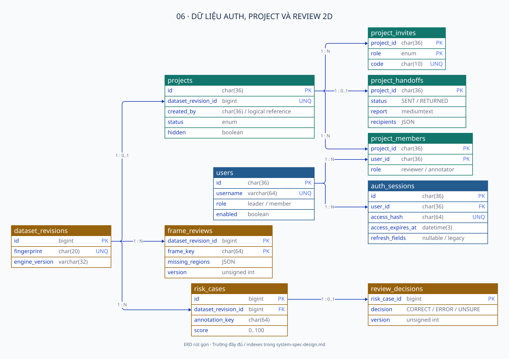

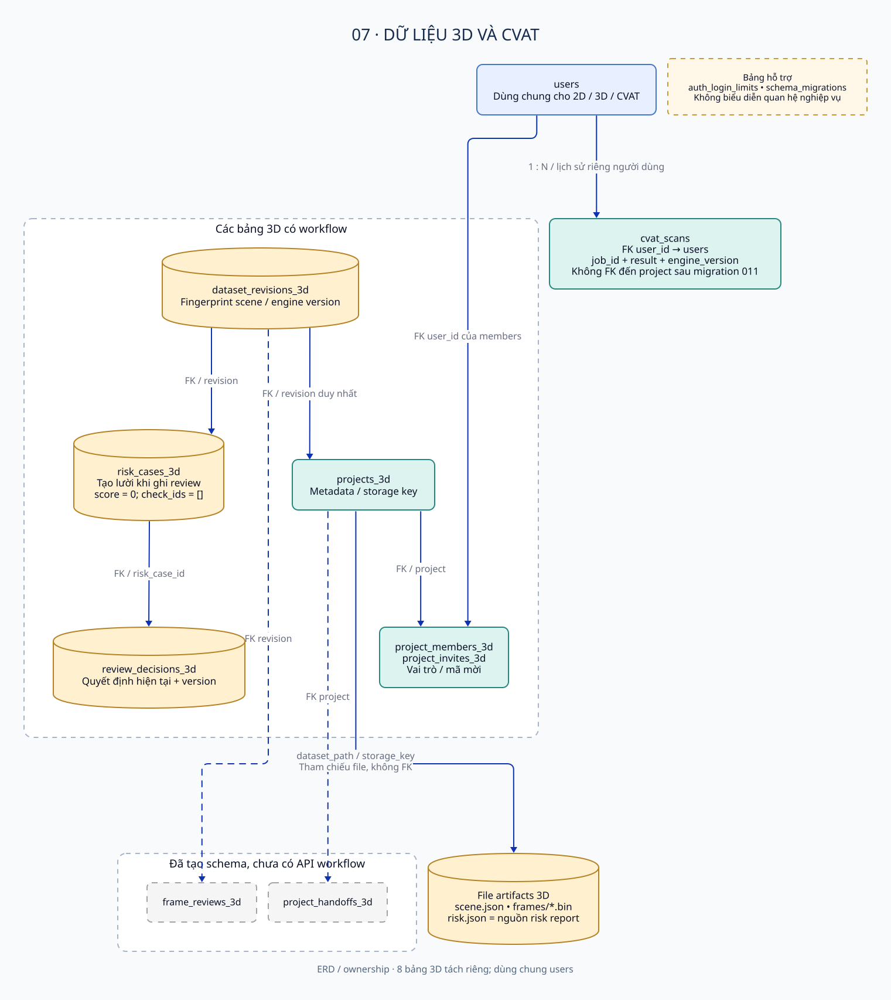

Schema được tái dựng từ migrations 001–011, không lấy từ live DB. Sau migration 011 có **21 bảng tính cả `schema_migrations`**: 11 bảng auth/project/review 2D, 8 bản sao 3D, `cvat_scans` và tracker migration. `cvat_scans` cuối cùng thuộc user, không thuộc project; migration 011 drop bảng scan cũ. Các bảng 3D tách riêng nhưng users dùng chung. `frame_reviews_3d` / `project_handoffs_3d` tồn tại ở schema mà chưa có API workflow tương ứng.

3D risk report nằm ở `risk.json`. `risk_cases_3d` chỉ tạo lười khi ghi review với score 0 / check_ids rỗng; không dùng bảng này như kho điểm engine. `review_decisions` và bản 3D giữ quyết định mới nhất + version, không có append-only audit log.

Nguồn: [web/server/db/migrations/008_projects_3d.sql:6](https://github.com/sithanh1602/Smartreview-Build/blob/8a91f5c911173453d9cacc743899c6e018e6fdc3/web/server/db/migrations/008_projects_3d.sql#L6), [web/server/db/migrations/009_session_hour_and_hidden_projects.sql:9](https://github.com/sithanh1602/Smartreview-Build/blob/8a91f5c911173453d9cacc743899c6e018e6fdc3/web/server/db/migrations/009_session_hour_and_hidden_projects.sql#L9), [web/server/db/migrations/011_cvat_scans_per_user.sql:1](https://github.com/sithanh1602/Smartreview-Build/blob/8a91f5c911173453d9cacc743899c6e018e6fdc3/web/server/db/migrations/011_cvat_scans_per_user.sql#L1), [web/server/db/migrate.ts:13](https://github.com/sithanh1602/Smartreview-Build/blob/8a91f5c911173453d9cacc743899c6e018e6fdc3/web/server/db/migrate.ts#L13), [web/server/projects3d/reviews.ts:68](https://github.com/sithanh1602/Smartreview-Build/blob/8a91f5c911173453d9cacc743899c6e018e6fdc3/web/server/projects3d/reviews.ts#L68).

### 8.2. Files và cache

```text
SMARTREVIEW_STORAGE/
├── projects/<project-uuid>/<import-uuid>/
│   ├── annotations/                 # source labels, optional image metadata CSV
│   ├── media/                       # images
│   ├── guideline/                   # original guideline + rule choices if provided
│   ├── dataset.json
│   └── risk/report.json
├── projects/<project-uuid>/ai/latest.json
├── projects/<project-uuid>/verify/latest.json
├── Project3D/<project-uuid>/<import-uuid>/
│   ├── scene.json
│   ├── frames/<timestamp>.bin
│   ├── cameras/<CAMERA>/<timestamp>.jpg
│   ├── sheets/<timestamp>.jpg
│   └── risk.json
└── .tmp/                            # worker/export/download staging
```

Sơ đồ cây mô tả layout, không bảo đảm mọi file tùy chọn có ở mọi project. Khi return nhãn 2D, bản gửi cũ được giữ thành `dataset.sent-<timestamp>.json`, còn `dataset.json` được thay bằng bản mới. Repository dựng lại report từ dataset/engine/waivers khi tải context; `risk/report.json` là snapshot import, không được returnFixed hay verifier ghi lại như một report hiện tại duy nhất. Nguồn: [web/server/projects/service.ts:465](https://github.com/sithanh1602/Smartreview-Build/blob/8a91f5c911173453d9cacc743899c6e018e6fdc3/web/server/projects/service.ts#L465), [web/server/repository.ts:77](https://github.com/sithanh1602/Smartreview-Build/blob/8a91f5c911173453d9cacc743899c6e018e6fdc3/web/server/repository.ts#L77). Khi remote được bật, keys tương tự nằm trên Dropbox; local import staging chỉ xóa sau publish / commit thành công, AI results lưu remote theo project. 2D image cache giới hạn 64 MiB, 3D file cache 128 MiB; cache ở bộ nhớ từng process. Browser viewer giữ tối đa 40 cloud frame. Nguồn: [web/server/projects/service.ts:52](https://github.com/sithanh1602/Smartreview-Build/blob/8a91f5c911173453d9cacc743899c6e018e6fdc3/web/server/projects/service.ts#L52), [web/server/projects3d/service.ts:33](https://github.com/sithanh1602/Smartreview-Build/blob/8a91f5c911173453d9cacc743899c6e018e6fdc3/web/server/projects3d/service.ts#L33), [web/server/ai/service.ts:50](https://github.com/sithanh1602/Smartreview-Build/blob/8a91f5c911173453d9cacc743899c6e018e6fdc3/web/server/ai/service.ts#L50), [web/server/verify/service.ts:60](https://github.com/sithanh1602/Smartreview-Build/blob/8a91f5c911173453d9cacc743899c6e018e6fdc3/web/server/verify/service.ts#L60), [web/src/features/projects3d/viewer/engine.ts:75](https://github.com/sithanh1602/Smartreview-Build/blob/8a91f5c911173453d9cacc743899c6e018e6fdc3/web/src/features/projects3d/viewer/engine.ts#L75).

### 8.3. Định danh và concurrency

- Project UUID; SQL revision là bigint nội bộ; `dataset_revision` HTTP là fingerprint 20 hex. Không tráo ba loại này.
- Fingerprint 2D lấy SHA-256 của namespace + dataset text + engine version + effective waivers, cắt 20 hex. Không là content hash thuần của ảnh.
- Fingerprint 3D dựa project ID + scene text; rescore risk không đổi fingerprint scene.
- Annotation/frame IDs được băm SHA-256 thành keys 64 hex ở index SQL; raw references vẫn được giữ.
- Review cần đúng revision và version. Case update dùng transaction / row locks; frame update dùng compare-and-swap. Track 3D là ngoại lệ overwrite cả đối tượng.

SQL transaction không bao gồm filesystem/Dropbox. Publish remote, revision registration, handoff return và cleanup có cửa sổ lỗi; `cleanupPending`, resume và recovery là các cơ chế giảm thiểu hiện có, không phải distributed transaction. Nhiều replicas chia sẻ DB/Dropbox vẫn không chia sẻ memory guards, pending jobs hoặc cache invalidation. Không coi cấu hình này đã hỗ trợ horizontal scaling an toàn.

Nguồn: [web/server/repository.ts:83](https://github.com/sithanh1602/Smartreview-Build/blob/8a91f5c911173453d9cacc743899c6e018e6fdc3/web/server/repository.ts#L83), [web/server/projects3d/service.ts:348](https://github.com/sithanh1602/Smartreview-Build/blob/8a91f5c911173453d9cacc743899c6e018e6fdc3/web/server/projects3d/service.ts#L348), [web/server/reviews/store.ts:160](https://github.com/sithanh1602/Smartreview-Build/blob/8a91f5c911173453d9cacc743899c6e018e6fdc3/web/server/reviews/store.ts#L160), [web/server/frames/store.ts:64](https://github.com/sithanh1602/Smartreview-Build/blob/8a91f5c911173453d9cacc743899c6e018e6fdc3/web/server/frames/store.ts#L64), [web/server/projects/service.ts:188](https://github.com/sithanh1602/Smartreview-Build/blob/8a91f5c911173453d9cacc743899c6e018e6fdc3/web/server/projects/service.ts#L188).

## 9. Security boundaries

Auth dùng opaque token 32 byte, server chỉ lưu SHA-256; fixed session 60 phút, không refresh. Cookie `access_token`: HttpOnly, SameSite=Strict, Path=/api, Max-Age=3600, Secure theo cấu hình; production startup từ chối khi Secure tắt. Node không tự terminate TLS. Password scrypt N=131072/r=8/p=1, salt 16 byte; đầu vào 12–128 ký tự.

Write requests kiểm tra Origin host và chặn `Sec-Fetch-Site: cross-site`; thiếu Origin vẫn có thể được chấp nhận. Throttle theo DB 15 phút: login account 10, login IP 100, register IP 10; tối đa 2 scrypt operations đồng thời trong instance. Reverse proxy có thể khiến `remoteAddress` trở thành IP proxy; source không cung cấp cơ chế trusted forwarded-IP hoàn chỉnh.

Upload kiểm tra path traversal, loại file, decoding/dimensions, tham chiếu; assets trả `nosniff`/sandbox và yêu cầu auth. 3D artifacts có thể dùng private immutable cache khi query có `dataset`; code không so query đó với fingerprint hiện tại trong stored-file branch. JSON API `no-store`. Không có evidence về antivirus, at-rest encryption do app, append-only audit, tenant isolation độc lập, HA hay disaster recovery đã triển khai.

CVAT server token và optional module ngoài `GUIDELINE_RULES_DIR` là trust boundaries đáng chú ý. Secrets phải ở môi trường server; guideline prose gửi Gemini là một data egress thực tế. Webcam inference là browser-local trong đường gọi đã trace.

Nguồn: [web/server/auth/service.ts:8](https://github.com/sithanh1602/Smartreview-Build/blob/8a91f5c911173453d9cacc743899c6e018e6fdc3/web/server/auth/service.ts#L8), [web/server/auth/password.ts:4](https://github.com/sithanh1602/Smartreview-Build/blob/8a91f5c911173453d9cacc743899c6e018e6fdc3/web/server/auth/password.ts#L4), [web/server/auth/http.ts:23](https://github.com/sithanh1602/Smartreview-Build/blob/8a91f5c911173453d9cacc743899c6e018e6fdc3/web/server/auth/http.ts#L23), [web/server/auth/http.ts:14](https://github.com/sithanh1602/Smartreview-Build/blob/8a91f5c911173453d9cacc743899c6e018e6fdc3/web/server/auth/http.ts#L14), [web/server/auth/service.ts:109](https://github.com/sithanh1602/Smartreview-Build/blob/8a91f5c911173453d9cacc743899c6e018e6fdc3/web/server/auth/service.ts#L109), [web/server/projects/upload.ts:23](https://github.com/sithanh1602/Smartreview-Build/blob/8a91f5c911173453d9cacc743899c6e018e6fdc3/web/server/projects/upload.ts#L23), [web/server/projects3d/http.ts:110](https://github.com/sithanh1602/Smartreview-Build/blob/8a91f5c911173453d9cacc743899c6e018e6fdc3/web/server/projects3d/http.ts#L110), [web/server/app.ts:220](https://github.com/sithanh1602/Smartreview-Build/blob/8a91f5c911173453d9cacc743899c6e018e6fdc3/web/server/app.ts#L220).

## 10. Deployment và cấu hình

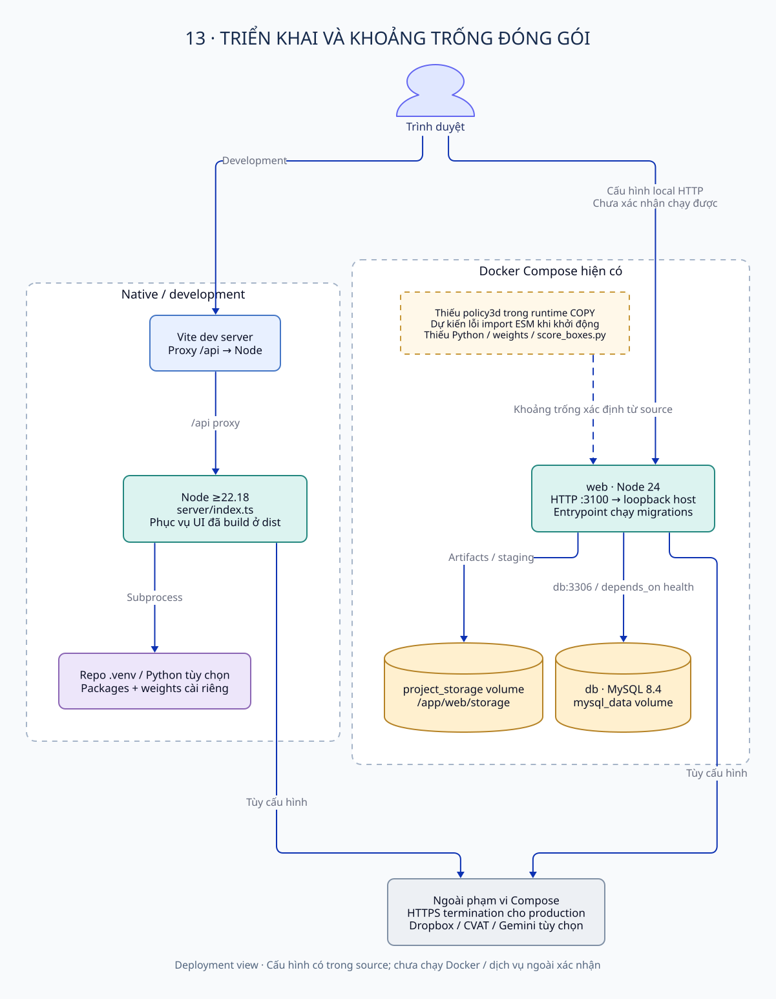

Native dev: Vite 5173 proxy `/api` tới Node 3100, preserve Host để same-origin checks hoạt động; dev script có SSH tunnel MySQL tùy chọn. Chạy `npm start` cần UI đã build, DB migrated và cấu hình server. `index.ts` không tự migrate; Docker entrypoint có chạy migrations trước API.

Compose hiện có Node 24 + MySQL 8.4, health dependency, named volumes, web bind host loopback; default local HTTP override `NODE_ENV=development` và cookie insecure. Production cần external HTTPS termination chưa được đóng gói trong Compose chính. Có overlay CVAT/nginx tùy chọn trong repo, dùng host network 8081 proxy CVAT 8080 và SmartReview 3100, inject Scan QA panel.

**Khoảng trống đóng gói xác định qua source:** Docker runtime COPY có `core` nhưng không có `policy3d`. Chuỗi eager import `index.ts → projects3d/service.ts → core/risk3d/engine.ts → policy3d/_scene.json` dự kiến lỗi ESM resolution trước listen; frontend build không thay backend import. Đây là kết luận tĩnh mạnh, **chưa chạy Docker xác nhận**. Runtime image cũng không có Python/venv/weights và không copy `ai-service/score_boxes.py`, nên chỉ bổ sung Python chưa đủ bật import rescore. CLI `npm run analyze` còn phụ thuộc `src/lib/zip.ts`, không nằm trong runtime COPY. Các lỗi này được ghi nhận, không sửa trong hồ sơ tài liệu.

Health endpoint chỉ trả `{ok:true}`, không probe DB / storage / model readiness. Docker healthcheck dùng endpoint này nên không chứng minh integration khỏe mạnh. Nguồn: [web/vite.config.ts:22](https://github.com/sithanh1602/Smartreview-Build/blob/8a91f5c911173453d9cacc743899c6e018e6fdc3/web/vite.config.ts#L22), [web/scripts/dev.ts:54](https://github.com/sithanh1602/Smartreview-Build/blob/8a91f5c911173453d9cacc743899c6e018e6fdc3/web/scripts/dev.ts#L54), [docker/entrypoint.sh:5](https://github.com/sithanh1602/Smartreview-Build/blob/8a91f5c911173453d9cacc743899c6e018e6fdc3/docker/entrypoint.sh#L5), [Dockerfile:15](https://github.com/sithanh1602/Smartreview-Build/blob/8a91f5c911173453d9cacc743899c6e018e6fdc3/Dockerfile#L15), [web/core/risk3d/engine.ts:6](https://github.com/sithanh1602/Smartreview-Build/blob/8a91f5c911173453d9cacc743899c6e018e6fdc3/web/core/risk3d/engine.ts#L6), [web/server/analysis/archive.ts:12](https://github.com/sithanh1602/Smartreview-Build/blob/8a91f5c911173453d9cacc743899c6e018e6fdc3/web/server/analysis/archive.ts#L12), [web/server/app.ts:64](https://github.com/sithanh1602/Smartreview-Build/blob/8a91f5c911173453d9cacc743899c6e018e6fdc3/web/server/app.ts#L64), [Dockerfile:23](https://github.com/sithanh1602/Smartreview-Build/blob/8a91f5c911173453d9cacc743899c6e018e6fdc3/Dockerfile#L23).

Danh mục biến môi trường và runbook kiểm tra nằm trong [đặc tả](system-spec-design.md#10-cấu-hình-và-vận-hành).

## 11. Trade-offs và vấn đề hiện tại

| Quyết định quan sát được | Lợi ích | Hạn chế / hệ quả |
|---|---|---|
| Modular monolith + native HTTP | Cùng types/core, ít hạ tầng | Routing/validation tự quản lý; inference/export làm request dài |
| Python subprocess per run | Tách ecosystem ML khỏi Node, đơn giản quản lý lifetime | Cold model load, deployment packages/weights phức tạp, state job không bền |
| JSON/file artifacts + SQL review | Giữ geometry linh hoạt, media không phình DB | Backup/restore phải đồng bộ hai kho; consistency không atomic |
| Policy JSON + engine snapshots | Trace ngưỡng và đọc revision cũ | Nhiều code legacy; metadata proposal dễ bị hiểu nhầm active |
| Bảng 2D và 3D riêng | Ít ảnh hưởng logic 2D | Duplicate schema/service và bảng chưa có workflow |
| Latest-row decisions / handoff | Đọc trạng thái hiện tại đơn giản | Không lưu lịch sử chỉnh sửa / mọi vòng handoff |
| Whole-track overwrite | Review nhanh một đối tượng | Có thể ghi đè review frame đồng thời; khác CAS từng box |
| Local memory guards/cache | Dễ chạy một instance | Không durable scheduling / phối hợp multi-instance |
| Generic unknown-error 503 | Không lộ lỗi nội bộ cho client | Lỗi lập trình cũng có thể hiển thị như mất kết nối dữ liệu |

Ưu tiên đề xuất cho vòng cải thiện sau (chưa thực hiện): sửa runtime COPY trước khi dựa vào Docker; readiness tách health; chuẩn hóa durable jobs/recovery nếu cần nhiều replicas; audit history và artifact/SQL consistency nếu có yêu cầu truy vết vận hành; đo lại policy trên dữ liệu đại diện. Không coi các đề xuất này là requirement đã đạt.

## 12. Ma trận bằng chứng trọng yếu

| Nhận định | Source gốc | Mức kiểm chứng |
|---|---|---|
| Một Node HTTP app, không AI REST service riêng | [web/server/index.ts:27](https://github.com/sithanh1602/Smartreview-Build/blob/8a91f5c911173453d9cacc743899c6e018e6fdc3/web/server/index.ts#L27), [web/server/ai/service.ts:186](https://github.com/sithanh1602/Smartreview-Build/blob/8a91f5c911173453d9cacc743899c6e018e6fdc3/web/server/ai/service.ts#L186) | Trace source |
| Shared UI/server types không thay validation runtime | [web/src/types.ts:22](https://github.com/sithanh1602/Smartreview-Build/blob/8a91f5c911173453d9cacc743899c6e018e6fdc3/web/src/types.ts#L22), [web/core/schema/normalize.ts:1](https://github.com/sithanh1602/Smartreview-Build/blob/8a91f5c911173453d9cacc743899c6e018e6fdc3/web/core/schema/normalize.ts#L1) | Source + core test |
| Engine 2D 7.1.0 / 3D 3d-1.11.0 | [web/core/risk/engine.ts:62](https://github.com/sithanh1602/Smartreview-Build/blob/8a91f5c911173453d9cacc743899c6e018e6fdc3/web/core/risk/engine.ts#L62), [web/core/risk3d/engine.ts:9](https://github.com/sithanh1602/Smartreview-Build/blob/8a91f5c911173453d9cacc743899c6e018e6fdc3/web/core/risk3d/engine.ts#L9) | Source + risk tests |
| Publish/SQL 2D chạy nền, phần trước vẫn awaited | [web/server/projects/service.ts:711](https://github.com/sithanh1602/Smartreview-Build/blob/8a91f5c911173453d9cacc743899c6e018e6fdc3/web/server/projects/service.ts#L711) | Trace source |
| Verifier requeue, AI Check không đổi risk | [web/server/verify/queue.ts:40](https://github.com/sithanh1602/Smartreview-Build/blob/8a91f5c911173453d9cacc743899c6e018e6fdc3/web/server/verify/queue.ts#L40), [web/server/ai/service.ts:8](https://github.com/sithanh1602/Smartreview-Build/blob/8a91f5c911173453d9cacc743899c6e018e6fdc3/web/server/ai/service.ts#L8) | Trace source |
| CVAT scans theo user, không project | [web/server/db/migrations/011_cvat_scans_per_user.sql:5](https://github.com/sithanh1602/Smartreview-Build/blob/8a91f5c911173453d9cacc743899c6e018e6fdc3/web/server/db/migrations/011_cvat_scans_per_user.sql#L5), [web/server/cvat/scans.ts:256](https://github.com/sithanh1602/Smartreview-Build/blob/8a91f5c911173453d9cacc743899c6e018e6fdc3/web/server/cvat/scans.ts#L256) | Schema + query |
| 3D case SQL không là risk store | [web/server/projects3d/reviews.ts:68](https://github.com/sithanh1602/Smartreview-Build/blob/8a91f5c911173453d9cacc743899c6e018e6fdc3/web/server/projects3d/reviews.ts#L68), [web/server/projects3d/http.ts:72](https://github.com/sithanh1602/Smartreview-Build/blob/8a91f5c911173453d9cacc743899c6e018e6fdc3/web/server/projects3d/http.ts#L72) | Trace source |
| Schema 3D có phần chưa có workflow | [web/server/db/migrations/008_projects_3d.sql:10](https://github.com/sithanh1602/Smartreview-Build/blob/8a91f5c911173453d9cacc743899c6e018e6fdc3/web/server/db/migrations/008_projects_3d.sql#L10), [web/server/projects3d/http.ts:9](https://github.com/sithanh1602/Smartreview-Build/blob/8a91f5c911173453d9cacc743899c6e018e6fdc3/web/server/projects3d/http.ts#L9) | Schema + route inventory |
| Docker thiếu policy3d | [Dockerfile:15](https://github.com/sithanh1602/Smartreview-Build/blob/8a91f5c911173453d9cacc743899c6e018e6fdc3/Dockerfile#L15), [web/core/risk3d/engine.ts:6](https://github.com/sithanh1602/Smartreview-Build/blob/8a91f5c911173453d9cacc743899c6e018e6fdc3/web/core/risk3d/engine.ts#L6) | Static packaging; chưa Docker runtime |

Kết quả kiểm tra cụ thể, manifest artifacts và giới hạn kiểm chứng được ghi tại [README](README.md#kiểm-chứng).
