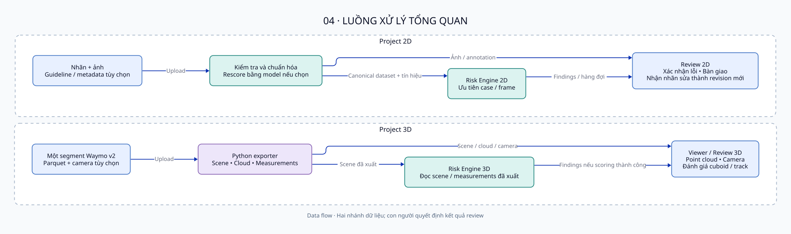

# SmartReview — Đặc tả và thiết kế tổng quan

**Mục đích:** mô tả hệ thống làm gì và các thành phần phối hợp như thế nào. Tài liệu tập trung vào thiết kế tổng quan; không dùng thay danh mục API hoặc schema triển khai chi tiết.  
**Source baseline:** `0a2b6451000b7ce681b3aa2b5a2b1a72d7a5f20f` trên HoangBranch.

## 1. Mục tiêu và phạm vi

SmartReview hỗ trợ nhóm annotation kiểm tra chất lượng dữ liệu 2D/3D bằng cách ưu tiên các trường hợp đáng xem xét, hiển thị bằng chứng và ghi nhận quyết định của con người.

Phạm vi hiện có gồm tài khoản/phân quyền, project 2D/3D, import và chuẩn hóa, rule-based risk analysis, review, handoff/return nhãn 2D, các tác vụ AI tùy chọn, guideline analysis và CVAT Scan QA. Không coi tự sửa nhãn, tự ghi nhãn về CVAT hoặc tự biến mọi guideline thành quy tắc thực thi là tính năng đã có.

## 2. Người dùng và quyền

| Vai trò | Nhiệm vụ chính |
|---|---|
| Leader | Tạo/import project, quản lý thành viên, chạy tác vụ AI, quản lý quá trình review |
| Reviewer | Đánh giá các trường hợp và bàn giao lỗi trong project được cấp quyền |
| Annotator | Xem lỗi được bàn giao, sửa nhãn bên ngoài, trả nhãn và chạy Scan QA |

Tài khoản có role `leader/member`; reviewer/annotator là role theo project của member. Backend quyết định quyền thực tế. Cả reviewer và annotator có quyền project đều có thể ghi review qua API. Leader được thao tác với project mà họ được phép thấy; việc ẩn/xóa có ràng buộc creator. Với return nhãn 2D, Leader hoặc annotator thuộc danh sách nhận handoff được gửi lại; reviewer không được return.

Nguồn: [web/server/projects/members.ts:59](https://github.com/sithanh1602/Smartreview-Build/blob/0a2b6451000b7ce681b3aa2b5a2b1a72d7a5f20f/web/server/projects/members.ts#L59), [web/server/projects/http.ts:90](https://github.com/sithanh1602/Smartreview-Build/blob/0a2b6451000b7ce681b3aa2b5a2b1a72d7a5f20f/web/server/projects/http.ts#L90), [web/server/projects/handoff.ts:272](https://github.com/sithanh1602/Smartreview-Build/blob/0a2b6451000b7ce681b3aa2b5a2b1a72d7a5f20f/web/server/projects/handoff.ts#L272).

## 3. Yêu cầu chức năng

| ID | Yêu cầu hiện có | Kết quả mong đợi theo implementation |
|---|---|---|
| FR-01 | Đăng ký, đăng nhập, đăng xuất và kiểm tra session | Người dùng truy cập theo tài khoản và phiên còn hiệu lực |
| FR-02 | Quản lý project và thành viên | Project có dữ liệu, trạng thái và phạm vi truy cập riêng |
| FR-03 | Import dữ liệu 2D | Nhãn/ảnh được kiểm tra và chuyển thành canonical dataset |
| FR-04 | Phân tích rủi ro 2D và review | Có findings/hàng đợi, xem ảnh và lưu đánh giá case/frame |
| FR-05 | Bàn giao và nhận nhãn sửa 2D | Lưu snapshot lỗi, nhận file sửa và tạo revision mới |
| FR-06 | Import, hiển thị và review Waymo 3D | Có scene/cloud/camera và quyết định cuboid/track |
| FR-07 | Dùng AI bổ trợ khi được yêu cầu | Có rescore, comparison hoặc class-verification findings theo chức năng được chọn |
| FR-08 | Dùng integrations tùy chọn | Dropbox lưu artifacts; CVAT cung cấp dữ liệu scan; Gemini trả guideline drafts |

Các chức năng này có code thực thi, nhưng tác vụ cần dịch vụ/model ngoài chỉ chạy được khi môi trường đã cấu hình đủ. Nguồn: [web/server/app.ts:43](https://github.com/sithanh1602/Smartreview-Build/blob/0a2b6451000b7ce681b3aa2b5a2b1a72d7a5f20f/web/server/app.ts#L43), [web/server/projects/http.ts:47](https://github.com/sithanh1602/Smartreview-Build/blob/0a2b6451000b7ce681b3aa2b5a2b1a72d7a5f20f/web/server/projects/http.ts#L47), [web/server/projects3d/http.ts:9](https://github.com/sithanh1602/Smartreview-Build/blob/0a2b6451000b7ce681b3aa2b5a2b1a72d7a5f20f/web/server/projects3d/http.ts#L9), [web/server/guideline/http.ts:11](https://github.com/sithanh1602/Smartreview-Build/blob/0a2b6451000b7ce681b3aa2b5a2b1a72d7a5f20f/web/server/guideline/http.ts#L11).

## 4. Yêu cầu phi chức năng

| Chủ đề | Cơ chế hiện tại | Giới hạn |
|---|---|---|
| Bảo mật | Session cookie, password/token hashing, server RBAC, kiểm tra nguồn request và upload | Không thay thế HTTPS, quản trị secrets hoặc kiểm thử bảo mật |
| Nhất quán | Revision/version, transactions cho review | Không atomic giữa SQL và kho file; whole-track review có thể overwrite |
| Tài nguyên | Giới hạn upload, worker timeouts và cache | Chưa có benchmark tải hoặc SLA được xác nhận |
| Phục hồi | Trạng thái lỗi, recovery import, resume 2D khi staging còn | Pending jobs nằm trong memory, không bền qua restart |
| Khả năng bảo trì | Tách UI/server/core/shared và lưu policy riêng | Cần cập nhật docs khi source hoặc policy thay đổi |

Các dòng trên là cơ chế quan sát được trong code, không phải cam kết chất lượng đã được đo. Nguồn: [web/shared/review.ts:32](https://github.com/sithanh1602/Smartreview-Build/blob/0a2b6451000b7ce681b3aa2b5a2b1a72d7a5f20f/web/shared/review.ts#L32), [web/server/projects/upload.ts:11](https://github.com/sithanh1602/Smartreview-Build/blob/0a2b6451000b7ce681b3aa2b5a2b1a72d7a5f20f/web/server/projects/upload.ts#L11), [web/server/projects/service.ts:102](https://github.com/sithanh1602/Smartreview-Build/blob/0a2b6451000b7ce681b3aa2b5a2b1a72d7a5f20f/web/server/projects/service.ts#L102), [web/server/verify/service.ts:51](https://github.com/sithanh1602/Smartreview-Build/blob/0a2b6451000b7ce681b3aa2b5a2b1a72d7a5f20f/web/server/verify/service.ts#L51).

## 5. Use cases và quy trình

| Use case | Quy trình chính | Kết quả |
|---|---|---|
| UC-01 / Bắt đầu project | Leader tạo project, chọn dữ liệu và import | Project READY hoặc báo lỗi cần xử lý |
| UC-02 / Review 2D | Mở case/frame, xem ảnh và findings, lưu quyết định | CORRECT / ERROR / UNSURE hoặc frame review |
| UC-03 / Vòng sửa nhãn | Bàn giao snapshot → sửa ở công cụ ngoài → trả file nhãn | Revision mới và kết quả đối chiếu thay đổi |
| UC-04 / Review 3D | Import Waymo → mở viewer → xem cloud/camera → đánh giá box/track | Quyết định review gắn với scene revision |
| UC-05 / AI bổ trợ | Người dùng có quyền yêu cầu task → theo dõi trạng thái → xem kết quả | Kết quả theo loại tác vụ, không tự thay đánh giá con người |
| UC-06 / CVAT Scan QA | Nhập job ID → server đọc CVAT → phân tích → lưu kết quả | Báo cáo scan và lịch sử theo người dùng |
| UC-07 / Guideline | Gửi văn bản → nhận drafts → người dùng chọn trước khi import | Lưu lựa chọn; known checks phù hợp có thể được waiver |

Các nhánh lỗi chính gồm dữ liệu không hợp lệ, thiếu ảnh/components, thiếu quyền, xung đột review, thiếu Python/models hoặc lỗi dịch vụ ngoài. Hệ thống báo trạng thái/lỗi để người dùng xử lý; không coi task được nhận là đã thành công.

Nguồn: [web/server/projects/service.ts:575](https://github.com/sithanh1602/Smartreview-Build/blob/0a2b6451000b7ce681b3aa2b5a2b1a72d7a5f20f/web/server/projects/service.ts#L575), [web/server/projects/service.ts:435](https://github.com/sithanh1602/Smartreview-Build/blob/0a2b6451000b7ce681b3aa2b5a2b1a72d7a5f20f/web/server/projects/service.ts#L435), [web/server/projects3d/service.ts:288](https://github.com/sithanh1602/Smartreview-Build/blob/0a2b6451000b7ce681b3aa2b5a2b1a72d7a5f20f/web/server/projects3d/service.ts#L288), [web/server/cvat/http.ts:13](https://github.com/sithanh1602/Smartreview-Build/blob/0a2b6451000b7ce681b3aa2b5a2b1a72d7a5f20f/web/server/cvat/http.ts#L13), [web/shared/guideline-waivers.ts:25](https://github.com/sithanh1602/Smartreview-Build/blob/0a2b6451000b7ce681b3aa2b5a2b1a72d7a5f20f/web/shared/guideline-waivers.ts#L25).

## 6. Thiết kế dữ liệu và giao tiếp

### Dữ liệu chính

| Nhóm dữ liệu | Nội dung | Nơi lưu chính |
|---|---|---|
| User / Session | Tài khoản, role toàn cục và phiên đăng nhập | MySQL |
| Project / Membership | Metadata, trạng thái, thành viên và mã mời | MySQL; bảng 2D/3D tách riêng |
| Dataset / Scene | Annotation chuẩn hóa hoặc scene Waymo đã xuất | JSON trong local storage/Dropbox |
| Media / Point cloud | Ảnh, cloud binary và camera artifacts | Local storage/Dropbox |
| Revision / Review | Định danh dữ liệu và quyết định có version | MySQL |
| Risk / AI results | Findings, reports và kết quả tác vụ | Reports/artifacts; SQL index hỗ trợ review |
| Handoff / CVAT scan | Snapshot bàn giao 2D và lịch sử scan theo user | MySQL |

Quan hệ chính: project tham chiếu revision; revision có các case/quyết định; membership liên kết user với project. Media và geometry không được chuẩn hóa toàn bộ thành các hàng SQL. Với 3D, `risk.json` là report của engine; bảng case SQL phục vụ lưu review. Quyết định và handoff chủ yếu giữ trạng thái hiện tại, không là append-only audit history.

Nguồn: [web/server/db/migrations/001_review.sql:1](https://github.com/sithanh1602/Smartreview-Build/blob/0a2b6451000b7ce681b3aa2b5a2b1a72d7a5f20f/web/server/db/migrations/001_review.sql#L1), [web/server/db/migrations/006_project_roles.sql:11](https://github.com/sithanh1602/Smartreview-Build/blob/0a2b6451000b7ce681b3aa2b5a2b1a72d7a5f20f/web/server/db/migrations/006_project_roles.sql#L11), [web/server/db/migrations/008_projects_3d.sql:2](https://github.com/sithanh1602/Smartreview-Build/blob/0a2b6451000b7ce681b3aa2b5a2b1a72d7a5f20f/web/server/db/migrations/008_projects_3d.sql#L2), [web/server/db/migrations/011_cvat_scans_per_user.sql:3](https://github.com/sithanh1602/Smartreview-Build/blob/0a2b6451000b7ce681b3aa2b5a2b1a72d7a5f20f/web/server/db/migrations/011_cvat_scans_per_user.sql#L3), [web/server/projects3d/reviews.ts:68](https://github.com/sithanh1602/Smartreview-Build/blob/0a2b6451000b7ce681b3aa2b5a2b1a72d7a5f20f/web/server/projects3d/reviews.ts#L68).

### Giao tiếp giữa các thành phần

Browser gọi Node qua `/api`: JSON cho thao tác nghiệp vụ, multipart cho upload, binary cho ảnh/cloud. Node dùng SQL với MySQL, file operations hoặc Dropbox REST cho artifacts, và subprocess/file/stdio JSON cho Python. CVAT/Gemini được gọi bằng REST phía server.

Các API được chia theo nhóm auth, projects, projects3d, review/frame, AI tasks, CVAT và guideline. Đây là mô tả giao tiếp tổng quan; cấu trúc request/response cụ thể lấy từ handlers/validators của baseline, không suy rộng một body chung cho các nhóm khác nhau.

Nguồn: [web/server/app.ts:43](https://github.com/sithanh1602/Smartreview-Build/blob/0a2b6451000b7ce681b3aa2b5a2b1a72d7a5f20f/web/server/app.ts#L43), [web/server/projects/http.ts:47](https://github.com/sithanh1602/Smartreview-Build/blob/0a2b6451000b7ce681b3aa2b5a2b1a72d7a5f20f/web/server/projects/http.ts#L47), [web/server/projects3d/http.ts:9](https://github.com/sithanh1602/Smartreview-Build/blob/0a2b6451000b7ce681b3aa2b5a2b1a72d7a5f20f/web/server/projects3d/http.ts#L9), [web/server/ai/service.ts:186](https://github.com/sithanh1602/Smartreview-Build/blob/0a2b6451000b7ce681b3aa2b5a2b1a72d7a5f20f/web/server/ai/service.ts#L186).

## 7. Thiết kế AI và risk

Risk engines là code TypeScript thực hiện các checks theo policy, còn model inference là chức năng bổ trợ. Điểm rủi ro giúp sắp thứ tự kiểm tra, không phải xác suất nhãn sai.

| Luồng | Vai trò / tác động |
|---|---|
| Import rescore | Model bổ sung tín hiệu cho bbox và gợi ý thiếu trước initial risk analysis; không di chuyển annotation gốc |
| AI Check | So sánh predictions với nhãn, lưu kết quả riêng; không đổi risk score gốc |
| Label Verify | SigLIP và optional Qwen kiểm tra class; có thể bổ sung findings và đưa case vào queue |
| Waymo 3D | Python xuất geometry/measurements; risk engine đọc scene đã xuất |
| Guideline | Gemini đề xuất drafts; người dùng chọn; rule mới/chặt hơn chưa tự thành code thực thi |

YOLO catalog có lựa chọn pretrained và fine-tuned. Việc có tên model hoặc Python binary không chứng minh inference sẵn sàng; còn cần packages, weights và tài nguyên phù hợp. Không đưa con số accuracy/SLA chưa được xác nhận vào đặc tả này.

Nguồn: [web/server/ai/rescore.ts:36](https://github.com/sithanh1602/Smartreview-Build/blob/0a2b6451000b7ce681b3aa2b5a2b1a72d7a5f20f/web/server/ai/rescore.ts#L36), [web/server/ai/service.ts:8](https://github.com/sithanh1602/Smartreview-Build/blob/0a2b6451000b7ce681b3aa2b5a2b1a72d7a5f20f/web/server/ai/service.ts#L8), [web/server/verify/queue.ts:11](https://github.com/sithanh1602/Smartreview-Build/blob/0a2b6451000b7ce681b3aa2b5a2b1a72d7a5f20f/web/server/verify/queue.ts#L11), [web/core/risk3d/engine.ts:6](https://github.com/sithanh1602/Smartreview-Build/blob/0a2b6451000b7ce681b3aa2b5a2b1a72d7a5f20f/web/core/risk3d/engine.ts#L6), [web/shared/guideline-waivers.ts:25](https://github.com/sithanh1602/Smartreview-Build/blob/0a2b6451000b7ce681b3aa2b5a2b1a72d7a5f20f/web/shared/guideline-waivers.ts#L25).

## 8. Triển khai, cấu hình và giới hạn

Môi trường cần Node, MySQL và storage writable. UI được build bằng Vite; native dev có proxy API. Các chức năng Python cần môi trường riêng cùng packages/models. Compose cung cấp Node/MySQL và persistent volumes; HTTPS production cần được quản trị ngoài ứng dụng.

Cấu hình chính gồm DB connection, storage root/provider, cookie security, đường dẫn Python/models và credentials cho integrations tùy chọn. Không đưa giá trị secrets vào hồ sơ. Khi backup cần xem MySQL và artifacts là hai phần của cùng dữ liệu hệ thống.

**Giới hạn hiện tại:** jobs/cache chủ yếu trong memory; SQL và file storage không có distributed transaction; 3D tập trung một segment Waymo; một số bảng 3D chưa có workflow; chưa có audit history đầy đủ. Docker runtime còn thiếu policy3d và dependencies/assets AI cần thiết, nên không xem manifest có sẵn như bằng chứng đã chạy thành công.

**Phạm vi xác minh:** đã đối chiếu source và kiểm tra sơ đồ. Chưa chạy MySQL, CVAT, Dropbox, Gemini, models hoặc Docker end-to-end; không khẳng định readiness hay hiệu năng vận hành của các phần đó.

Nguồn: [web/server/config.ts:4](https://github.com/sithanh1602/Smartreview-Build/blob/0a2b6451000b7ce681b3aa2b5a2b1a72d7a5f20f/web/server/config.ts#L4), [web/server/index.ts:13](https://github.com/sithanh1602/Smartreview-Build/blob/0a2b6451000b7ce681b3aa2b5a2b1a72d7a5f20f/web/server/index.ts#L13), [web/server/storage/remote.ts:15](https://github.com/sithanh1602/Smartreview-Build/blob/0a2b6451000b7ce681b3aa2b5a2b1a72d7a5f20f/web/server/storage/remote.ts#L15), [web/vite.config.ts:22](https://github.com/sithanh1602/Smartreview-Build/blob/0a2b6451000b7ce681b3aa2b5a2b1a72d7a5f20f/web/vite.config.ts#L22), [Dockerfile:15](https://github.com/sithanh1602/Smartreview-Build/blob/0a2b6451000b7ce681b3aa2b5a2b1a72d7a5f20f/Dockerfile#L15), [web/core/risk3d/engine.ts:6](https://github.com/sithanh1602/Smartreview-Build/blob/0a2b6451000b7ce681b3aa2b5a2b1a72d7a5f20f/web/core/risk3d/engine.ts#L6).
