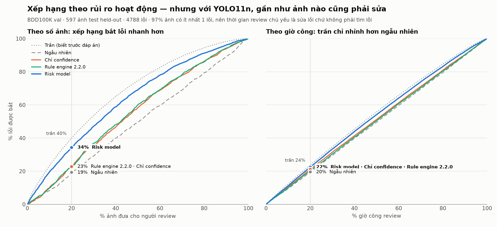

# Review Policy — Confidence-Based Human Review (BDD100K, lớp xe)

Policy quyết định ảnh nào người review phải xem, xem theo thứ tự nào, và ảnh nào được phép bỏ qua. Mọi con số dưới đây đo trên **597 ảnh test held-out** của BDD100K val; scorer và ngưỡng chỉ được fit trên **903 ảnh calibration**, chưa từng nhìn tập test. Pipeline và cách chạy lại: [`ai-service/risk/README.md`](../../ai-service/risk/README.md).

## Phạm vi

- **Đơn vị review là ảnh**, không phải box: reviewer mở một ảnh và sửa mọi lỗi trong đó.
- **Lớp:** car, truck, bus, motorcycle, bicycle. `train` loại (15 instance trên 10k ảnh val). `rider` loại khỏi đánh giá vì COCO không có lớp tương ứng.
- **Detector đang review:** YOLO11n pretrained COCO, `imgsz=1280`, ngưỡng làm việc 0.3.
- **Lỗi** = xe bị sót (FN), box thừa (FP), nhầm lớp, lệch vị trí (IoU 0.5–0.7).

## Ba tầng

| Tầng                 | Điều kiện                                 | Việc của reviewer                       |
| -------------------- | ----------------------------------------- | --------------------------------------- |
| **3 · Gán lại**      | 15% ảnh có số lỗi dự đoán cao nhất        | Xoá prelabel, vẽ lại từ đầu             |
| **2 · Xác minh**     | Mọi ảnh còn lại không đủ điều kiện tầng 1 | Xem từng box, sửa box sai, vẽ xe bị sót |
| **1 · Tự động nhận** | Risk ≤ τ **và** không vướng luật cứng     | Không xem                               |

**Luật cứng** — luôn ít nhất tầng 2, bất kể điểm: ảnh có bus (lớp hiếm, model yếu nhất), và ảnh đêm có ≥ 5 box vùng xám.

**Thứ tự trong hàng đợi:** giảm dần theo số lỗi dự đoán. Mỗi ảnh kèm lý do đọc được, ví dụ _"56 box vùng xám (nghi sót xe); 5 box confidence < 0.5; ảnh đêm"_.

## Risk score

`risk(ảnh)` = **số lỗi dự đoán**, từ Poisson regression trên tín hiệu chỉ lấy từ output detector và metadata ảnh, không dùng GT. Mục tiêu là số lỗi chứ không phải nhị phân "có lỗi": với YOLO11n, 97% ảnh có ít nhất một lỗi nên nhãn nhị phân không phân biệt được gì.

| Tín hiệu       | Ý nghĩa                                                                              | Hệ số            |
| -------------- | ------------------------------------------------------------------------------------ | ---------------- |
| `n_grey`       | Số box confidence 0.05–0.3 — dấu hiệu xe bị sót                                      | **0.443**        |
| `mean_score`   | Confidence trung bình các box ≥ 0.3                                                  | −0.159           |
| `n_pred`       | Số box ≥ 0.3                                                                         | 0.089            |
| `n_grey_small` | Box vùng xám nhỏ hơn 32px                                                            | 0.088            |
| `bad_weather`  | Mưa / tuyết / sương mù                                                               | −0.067           |
| còn lại        | `n_low`, `min_score`, `n_small_pred`, `max_overlap`, `no_pred`, `night`, `dawn_dusk` | \|hệ số\| < 0.05 |

Tín hiệu được chuẩn hoá trước khi fit, nên độ lớn hệ số so sánh được với nhau. Confidence là phần lõi: bỏ hết tín hiệu gốc confidence thì Spearman giữa risk và số lỗi thật giảm từ **0.75 xuống 0.44**. 5-fold CV trên calibration cho Spearman 0.73–0.83, ổn định giữa các fold.

## Kết quả

**Theo số ảnh** — % lỗi bắt được khi review X% ảnh, xếp theo risk:

| Phương pháp                                  | 10%       | 20%       | 30%       | 50%       |
| -------------------------------------------- | --------- | --------- | --------- | --------- |
| Ngẫu nhiên                                   | 8.3%      | 19.3%     | 29.4%     | 49.5%     |
| Chỉ confidence (score thấp nhất)             | 10.1%     | 22.8%     | 35.7%     | 58.2%     |
| Rule engine 2.1.0 (chưa có check confidence) | 10.5%     | 21.6%     | 31.6%     | 50.7%     |
| Rule engine 2.2.0 (có check confidence)      | 9.9%      | 22.8%     | 36.9%     | 60.2%     |
| **Risk model**                               | **19.5%** | **34.3%** | **47.3%** | **69.2%** |
| Trần (biết trước đáp án)                     | 23.3%     | 40.1%     | 53.7%     | 74.6%     |

Ở budget 20%, risk model đạt 86% mức trần và gấp 1.8 lần ngẫu nhiên.

**Theo giờ công** — % lỗi bắt được khi bỏ ra X% tổng giờ review (review toàn bộ = 37.3 giờ, cost model Su et al.: xác nhận 9s, sửa 20s, vẽ mới 25.5s mỗi box):

| Phương pháp                          | 10%   | 20%   | 30%   | 50%   |
| ------------------------------------ | ----- | ----- | ----- | ----- |
| Ngẫu nhiên                           | 9.5%  | 19.6% | 29.6% | 49.5% |
| Chỉ confidence                       | 10.8% | 21.2% | 31.5% | 51.5% |
| Risk model (lỗi / giây)              | 11.2% | 22.5% | 33.4% | 54.2% |
| Trần (lỗi / giây, biết trước đáp án) | 12.4% | 23.9% | 34.8% | 55.8% |

Theo giờ công, kể cả trần cũng chỉ hơn ngẫu nhiên khoảng 4 điểm. Nguyên nhân không nằm ở policy: 97% ảnh có lỗi, nên thời gian review chủ yếu dành cho **sửa** lỗi, và thời gian sửa tỷ lệ với số lỗi. Triage chỉ tiết kiệm được giờ khi có ảnh sạch để bỏ qua.

## Tầng 1 hiện đang rỗng

τ được chọn trên calibration: ngưỡng risk cao nhất mà cận trên Wilson 95% của tỷ lệ "ảnh tự động nhận vẫn còn sót xe" ≤ α = 2%, cần ít nhất 30 ảnh, rồi lùi xuống 10% để bù selection bias. **Với YOLO11n, không có ngưỡng nào đạt**, kể cả khi chỉ tính xe ≥ 64px.

| Tự động nhận X% ảnh risk thấp nhất | còn sót xe ≥ 10px | ≥ 32px | ≥ 64px | ≥ 128px |
| ---------------------------------- | ----------------- | ------ | ------ | ------- |
| 5%                                 | 79%               | 62%    | 38%    | 24%     |
| 20%                                | 88%               | 62%    | 36%    | 16%     |
| 50%                                | 93%               | 69%    | 40%    | 19%     |

Detector sót 56% số xe: 81% xe 10–32px, 24% xe ≥ 128px. 80% xe bị sót đang bị che khuất; ban đêm sót 67%, ban ngày 42%. Đã soi tay các ảnh có xe ≥ 128px bị sót (`ai-service/risk/results/matcher_check/`): đó là lỗi thật của detector — xe nhoè chuyển động ban đêm, truck bị cắt ở mép ảnh, xe đạp đậu san sát — không phải lỗi của bước matching.

**Policy vì vậy nói thẳng: với detector này, không ảnh nào được bỏ qua.** Đó là kết luận đúng chứ không phải thất bại — queue vẫn giúp reviewer xử lý ảnh nhiều lỗi trước.

**Điều kiện mở tầng 1:** chạy lại pipeline với detector mạnh hơn (YOLO11x, hoặc model fine-tune trên BDD100K), rồi chạy lại phân tích α. Pipeline không phụ thuộc model: chỉ cần thay file `predictions.json`.

## Định nghĩa α (đã chốt)

> **Trong các ảnh được tự động nhận, tỷ lệ ảnh còn sót ít nhất một xe có kích thước ≥ 64px (căn bậc hai diện tích box) không vượt quá 2%, tính theo cận trên Wilson 95%, với ít nhất 150 ảnh tự động nhận.**

Vì sao chọn mốc 64px thay vì 10px như plan ban đầu:

- **An toàn:** xe ≥ 64px trên ảnh 1280×720 là xe ở gần — loại mà sót thì nguy hiểm. Xe 10–32px là xe rất xa, chiếm 58% số xe bị sót.
- **Đo được:** với vật rất nhỏ, chính nhãn GT của BDD100K cũng không nhất quán. Đặt α trên những vật mà đáp án còn không chắc thì con số α không đáng tin.
- **Giữ nguyên độ chặt 2%** và cách tính "kịch bản xấu nhất" (Wilson) của plan. Chỉ đổi đối tượng được đo, không nới tiêu chuẩn.

Với YOLO11n, α theo định nghĩa này vẫn chưa đạt (xem bảng ở trên: 36–40% ảnh risk thấp vẫn sót xe ≥ 64px). Xe nhỏ hơn 64px vẫn được tính trong benchmark và vẫn được sửa ở tầng 2/3 — chỉ không dùng làm điều kiện cho phép bỏ qua ảnh.

**Tỷ lệ tầng 3:** 15% là giá trị tạm theo ngân sách review; điều chỉnh khi có ngân sách thật.

## Công bố (disclosure)

- 4,735 box xe GT nhỏ hơn 10×10 px (4.3% box xe) và 664 box `rider`/`train` là **vùng ignore**: prediction trùng vào đó không tính đúng, cũng không tính sai.
- Map lớp COCO → BDD: car, truck, bus, motorcycle, bicycle giữ nguyên tên.
- `timeofday` và `weather` lấy từ nhãn BDD100K do người gán. Khi triển khai thật phải ước lượng từ ảnh (ví dụ độ sáng trung bình).
- Simulator giả định reviewer hoàn hảo: ảnh được xem thì trở thành đúng như GT. Con số đo **giá trị của việc chọn đúng ảnh**, không đo kỹ năng reviewer.
- Ngưỡng `confidence.low` = 0.5 trong rule engine 2.2.0 chưa được hiệu chỉnh bằng GT.
